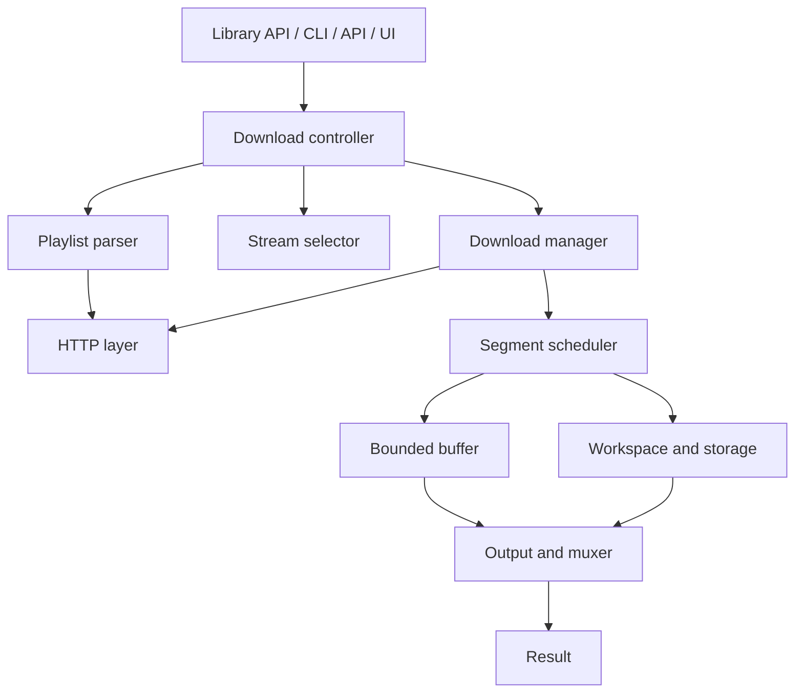

# Engine design

The HLS engine lives in the `rayohx` package. The command line, the API and the desktop window all call it, so download logic exists in one place. The engine never prints, exits or reads global state: it takes typed configuration and reports through events.

## Responsibilities

| Part | Job |
| --- | --- |
| Playlist parser | Tokenizing HLS parser for master and media playlists, with RFC 3986 URL resolution |
| Stream selector | Deterministic choice of video, audio and subtitle tracks from user constraints |
| HTTP layer | The only place that makes requests: pooling, retries, proxy, TLS, headers, cookies, redaction |
| Segment scheduler | Bounded worker pool, per-segment state, ordered delivery, cooperative cancellation |
| Workspace and storage | Safe workspace, storage strategies, disk checks, metrics, resume state |
| Output and muxer | Container detection and finalization (see below) |
| Events | Typed events and state changes that every front end consumes |

## Package layout

Modules are added phase by phase under `src/rayohx/`. The first group exists; the second is still to come.

| Module | Contents |
| --- | --- |
| `enums` | Download and segment states, event types, container, encryption, storage and output choices |
| `models` | Frozen dataclasses for playlists, tracks, segments, requests, progress and results |
| `config` | `DownloadConfig`, `NetworkConfig`, `ProxyConfig`, `OutputConfig`, `StorageConfig`, `SelectionConfig` |
| `errors` | The `RayoHXError` hierarchy |
| `events` | The download state machine and the `EventBus` |
| `redaction` | Hides secrets in URLs, headers and text |
| `logs` | Standard `logging` setup with a redaction filter |

Still to come: `playlist`, `selection`, `http`, `storage`, `scheduler`, `crypto`, `output`.

## Conventions

- **Immutable and validated.** Models and settings are frozen dataclasses. A settings object checks itself when it is created and raises `ConfigurationError`. Collections are stored as tuples or read-only mappings.
- **Secrets stay out.** Headers, cookies and proxy passwords are left out of `repr`, and `as_dict()` hides them, so the result is safe for logs and resume state. A `DownloadRequest` or `ProxyConfig` shows its address with credentials removed.
- **Events, not prints.** The engine reports through `DownloadEvent` objects delivered by an `EventBus`. A listener that raises is logged and never stops the download.
- **Explicit states.** `DownloadStateMachine` allows only the moves in `TRANSITIONS`, safely across threads. `COMPLETED`, `FAILED` and `CANCELLED` are final. A cancelled download ends as `CANCELLED`, not as a failure.
- **Errors say what to do.** Every `RayoHXError` has a redacted `message` and an optional `hint`. `describe()` joins them.
- **Logging.** Loggers live under `rayohx` and the library stays silent until an application calls `configure_logging`. Logs go to stderr, never stdout, and every record is redacted and tagged with the download id.

The greeting example (`core.py`, `greetings.py`) is temporary. It stays only until the API and window are moved onto the engine, then it is deleted.

## Output without FFmpeg

RayoHX does its own container handling and never bundles FFmpeg.

1. MPEG-TS segments are joined into a `.ts` file, and fMP4 segments (init segment plus fragments) into a fragmented `.mp4`. Neither step decodes anything.
2. A native muxer turns MPEG-TS into fragmented MP4 for H.264 and HEVC video with AAC, AC-3, E-AC-3 or MP3 audio. It is written from the public specifications.
3. WebVTT subtitles are written as a sidecar file.
4. For anything else, RayoHX uses an FFmpeg already installed on the machine, when found on `PATH`. It is a prerequisite for those cases only, and it runs as a separate program, never linked or shipped.

RayoHX remuxes and never transcodes. When no route exists, it raises `OutputFormatError` and says which stream or codec is the problem.

## Licensing

Every runtime dependency must be permissively licensed (MIT, BSD, Apache-2.0 and similar). CI runs `pip-licenses` and fails on any GPL-family license. PyInstaller, which is GPL-2.0 with a bootloader exception that permits bundling commercial applications, is only an installer-build tool and is not a runtime dependency. Do not copy code from GPL, LGPL or AGPL projects such as FFmpeg, Bento4 or GPAC; implement from the specifications instead.
