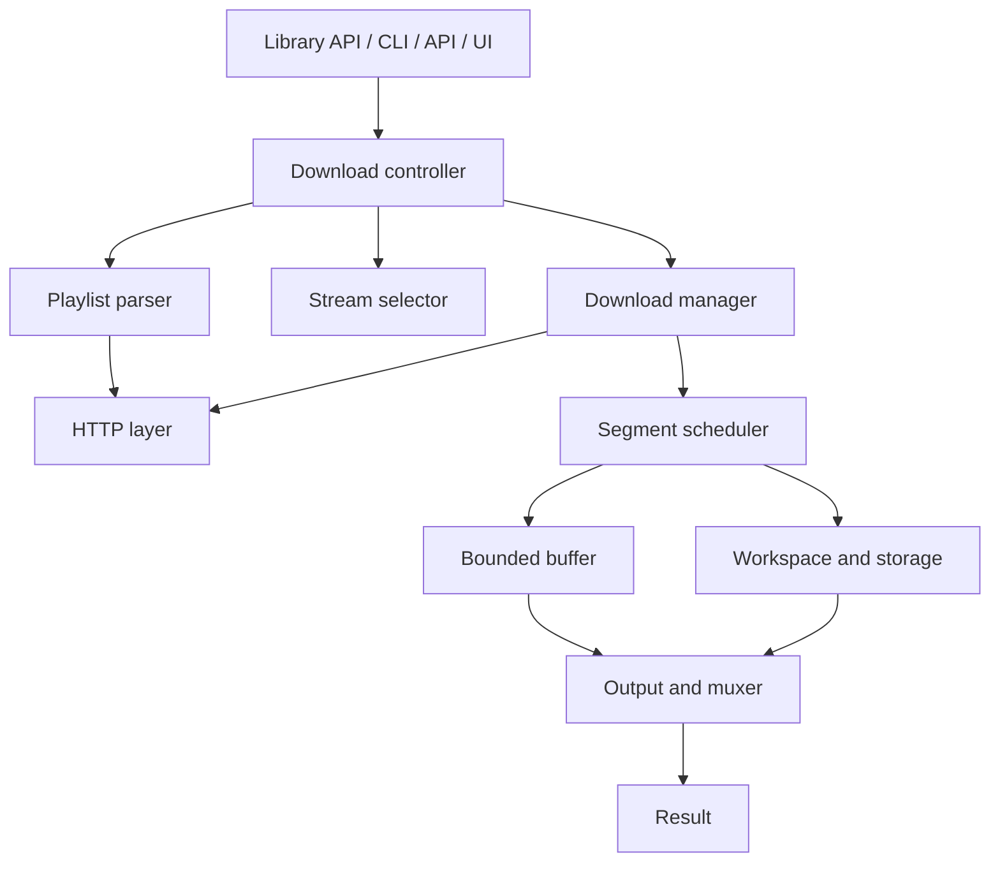

# Engine design

The HLS engine lives in the `rayohx` package. The command line, the API and the desktop window all call it, so download logic exists in one place. The engine never prints, exits or reads global state: it takes typed configuration and reports through events.

## Responsibilities

| Part | Job |
| --- | --- |
| Playlist parser | Tokenizing HLS parser for master and media playlists, with RFC 3986 URL resolution |
| Stream selector | Deterministic choice of video, audio and subtitle tracks from user constraints |
| HTTP layer | The only place that makes requests: pooling, retries, proxy, TLS, headers, cookies, redaction |
| Segment scheduler | Bounded worker pool, per-segment state, ordered delivery, cooperative cancellation |
| Workspace and storage | Safe workspace, storage strategies, disk checks, metrics, resume state |
| Output and muxer | Container detection and finalization (see below) |
| Events | Typed events and state changes that every front end consumes |

## Package layout

Modules are added phase by phase under `src/rayohx/`. The first group exists; the second is still to come.

| Module | Contents |
| --- | --- |
| `enums` | Download and segment states, event types, container, encryption, storage and output choices |
| `models` | Frozen dataclasses for playlists, tracks, segments, requests, progress and results |
| `config` | `DownloadConfig`, `NetworkConfig`, `ProxyConfig`, `OutputConfig`, `StorageConfig`, `SelectionConfig` |
| `errors` | The `RayoHXError` hierarchy |
| `playlist` | The HLS parser for master and media playlists |
| `selection` | Choosing the variant, audio and subtitle tracks |
| `inspection` | `inspect_playlist`, which looks at a stream without downloading it |
| `http_client` | `HttpClient`: the only code that makes network requests |
| `ratelimit` | A speed limit shared by all workers |
| `crypto` | AES-128 decryption and key retrieval |
| `fetcher` | Downloads and decrypts one segment |
| `storage` | Size estimates, disk-space checks, metrics and the segment stores |
| `workspace` | The private working folder, its lock and cleanup |
| `state` | Resume state, saved atomically |
| `sinks` | `FileSink` and `StreamSink`: where ordered segments go |
| `progress` | Speed, ETA and progress snapshots |
| `pipeline` | Parallel fetching with ordered writing |
| `media_download` | `MediaDownload`: one media playlist from start to finish |
| `containers` | Recognising and checking MPEG-TS and fMP4 data |
| `output` | Choosing the output name and format |
| `controller` | `Downloader` and `download()`: a web address to a finished file |
| `delivery` | The ways a stream becomes a file: plain, built-in remux, FFmpeg, and subtitles |
| `mux/` | The built-in remuxer: MPEG-TS demuxer, codec parsers, fragmented-MP4 writer and muxer, WebVTT, FFmpeg wrapper |
| `cancellation` | `CancellationToken` for cooperative cancellation |
| `events` | The download state machine and the `EventBus` |
| `redaction` | Hides secrets in URLs, headers and text |
| `logs` | Standard `logging` setup with a redaction filter |

Still to come: the command line over `download()`, and packaging.

## Conventions

- **Immutable and validated.** Models and settings are frozen dataclasses. A settings object checks itself when it is created and raises `ConfigurationError`. Collections are stored as tuples or read-only mappings.
- **Secrets stay out.** Headers, cookies and proxy passwords are left out of `repr`, and `as_dict()` hides them, so the result is safe for logs and resume state. A `DownloadRequest` or `ProxyConfig` shows its address with credentials removed.
- **Events, not prints.** The engine reports through `DownloadEvent` objects delivered by an `EventBus`. A listener that raises is logged and never stops the download.
- **Explicit states.** `DownloadStateMachine` allows only the moves in `TRANSITIONS`, safely across threads. `COMPLETED`, `FAILED` and `CANCELLED` are final. A cancelled download ends as `CANCELLED`, not as a failure.
- **Errors say what to do.** Every `RayoHXError` has a redacted `message` and an optional `hint`. `describe()` joins them.
- **Logging.** Loggers live under `rayohx` and the library stays silent until an application calls `configure_logging`. Logs go to stderr, never stdout, and every record is redacted and tagged with the download id.

The greeting example (`core.py`, `greetings.py`) is temporary. It stays only until the API and window are moved onto the engine, then it is deleted.

## Output without FFmpeg

RayoHX does its own container handling and never bundles or links FFmpeg. It *remuxes* (re-wraps compressed audio and video into another container) and never *transcodes*.

| Source | Output | How |
| --- | --- | --- |
| MPEG-TS, one stream | `.ts` | Segments joined in order |
| Fragmented MP4, one stream | `.mp4` | Initialization section, then the fragments |
| MPEG-TS, one stream | `.mp4` | Built-in remuxer |
| Any stream with separate audio | `.mp4` | Built-in remuxer joins the tracks |
| Codecs the built-in remuxer cannot copy | `.mp4` | An FFmpeg you have installed, if there is one |
| WebVTT subtitles | `<name>.<language>.vtt` | Segments merged and aligned with the video |

## The built-in remuxer

It is written from the public specifications (ISO/IEC 13818-1, 14496-12, 14496-14, 14496-15, 23008-2 and the Dolby and MPEG audio formats) and lives in `rayohx.mux`. The output is always a *fragmented* MP4, which can be written while the download is still running and needs no second pass over the file.

**Codecs copied from MPEG-TS:** H.264 and HEVC video; AAC (ADTS), AC-3, E-AC-3 (with dependent substreams) and MPEG audio (MP3 and MP2). **From fragmented MP4:** any codec, because the compressed data is passed through untouched: only the track header is copied (with a new track id and language).

How it works:

1. The demuxer follows the program tables, reassembles each stream's PES packets and reads their timestamps (33-bit values, unwrapped past the rollover).
2. A parser per codec turns each access unit into a sample and builds the codec configuration (`avcC`, `hvcC`, `esds`, `dac3`, `dec3`). Parameter sets move to the sample entry and out of the samples. Video before the first keyframe is dropped.
3. A fragmenter cuts each track into fragments (video at keyframes after at least a second, audio every two seconds) and closes up jumps in time.
4. The muxer holds each track's fragments until it knows no earlier fragment is coming from another track, then writes them oldest first, so audio and video stay interleaved. The file's timeline starts near zero while the offset between audio and video is kept exactly.
5. A track that is stored apart (a separate audio rendition) is downloaded to a hidden file beside the output and read back from disk as the muxer needs it, so it never has to fit in memory. The hidden file is removed afterwards, whatever happens.

**What a muxed download does not do:** resume. The remuxer's state cannot be saved, so an interrupted muxed download starts again. Plain downloads keep resuming as before. Progress for a stream with separate audio is reported per track (audio first, then video).

**Limits.** AAC with a custom channel layout, fragmented MP4 that holds several tracks in one fragment, and fragments with absolute data offsets are refused with a clear message. A change of video size or codec part-way through is not supported. Subtitles are saved only when they are WebVTT text; subtitles stored inside MP4 are not.

### How it is checked

The remuxer's output is compared with FFmpeg's, which did not write it. The tests (they need `ffmpeg` and `ffprobe` only to run these comparisons and skip them otherwise) check that for every supported codec combination:

- `ffprobe` identifies the codecs, picture size and sample rate;
- `ffmpeg` decodes the whole file without a single error;
- the **decoded pictures are bit-identical** to the original stream's, frame by frame (100 of 100 frames, and 3,000 of 3,000 in a two-minute 720p test);
- the **decoded sound is bit-identical**;
- the audio and video start times keep the same offset as in the source;
- the same holds when separate audio and video tracks are joined, from both MPEG-TS and fragmented MP4 sources.

The test media is real FFmpeg output, regenerated by `scripts/make_media_fixtures.py`.

### Speed and memory

Measured on one core, in pure Python, reading the stream from disk a megabyte at a time:

| Stream | Size | Speed (three runs) |
| --- | --- | --- |
| 2 minutes, 720p, 6 Mbit/s, H.264 and AAC | 96 MB | 131, 148 and 146 MB/s |
| 1 minute, 1080p, 20 Mbit/s, H.264 and AC-3 | 160 MB | 133, 141 and 134 MB/s |

The whole process stayed at about 68 MB of memory for both, so memory does not grow with the size of the stream: it holds a few segments plus the fragments waiting for another track, which are capped at 64 MiB. Remuxing is therefore much faster than any realistic download. These figures are from one machine and are meant as a rough guide, not a promise.

## FFmpeg, when it is needed

FFmpeg is an **optional prerequisite**, never required and never shipped, because of its licensing. It is used only when:

- the stream has a codec the built-in remuxer cannot copy (for example MPEG-2 video), and an FFmpeg is found on the `PATH` or at `OutputConfig.ffmpeg_path`; or
- you ask for it with `RemuxBackend.FFMPEG`.

The choice is made before the download starts, by reading the first segment's program map, so a download never changes tool half-way. With `RemuxBackend.NATIVE` FFmpeg is never used, and with `RemuxBackend.AUTO` (the default) it is used only as the fallback. When the stream needs FFmpeg and none is installed, the error says so and names the codec.

FFmpeg runs as a separate program on files that have already been downloaded, with fixed arguments and no shell. It is only asked to copy streams (`-c copy`); the one change it makes is rewriting the headers of AAC from a transport stream, which does not alter the sound. If it fails, its last message is shown (with secrets removed) and nothing is left behind. Because FFmpeg needs whole files, this route stores the pieces on disk before joining them.

## Licensing

Every runtime dependency must be permissively licensed (MIT, BSD, Apache-2.0 and similar). CI runs `pip-licenses` and fails on any GPL-family license. PyInstaller, which is GPL-2.0 with a bootloader exception that permits bundling commercial applications, is only an installer-build tool and is not a runtime dependency. Do not copy code from GPL, LGPL or AGPL projects such as FFmpeg, Bento4 or GPAC; implement from the specifications instead.

## Playlists and selection

**Parsing.** `parse_playlist(text, uri)` reads a master or media playlist and returns the typed models, with every address made absolute using RFC 3986 rules against the playlist's own (final) address.

- A playlist is recognised by its `#EXTM3U` header, never by its file name or address.
- Tags the parser does not know are skipped, so newer playlists keep working.
- Errors name the line. A web page or other non-playlist gets a hint to check the address, headers and cookies.
- Playlist variables (`EXT-X-DEFINE`) and I-frame-only playlists are refused with `UnsupportedPlaylistError`, because ignoring them would produce wrong addresses or wrong video.
- Segments and playlists must be `http` or `https`. Key addresses may use another scheme so that a SAMPLE-AES or DRM playlist can still be inspected. The key is marked unsupported and the download refuses it later.
- A key without an `IV` keeps `iv=None`. The decrypting phase derives it from the segment's `sequence_number`, as the HLS specification says.
- `EXT-X-BYTERANGE` ranges without an offset are resolved against the previous range of the same file.
- The container (MPEG-TS, fMP4, WebVTT) is guessed from the playlist. When it is unclear it stays `UNKNOWN` and the first bytes of a segment settle it.

**Inspecting.** `inspect_playlist(url, fetcher)` downloads no media. The fetcher is any object with `fetch_text(url)`, which returns the text and its final address after redirects. `HttpClient` is the real one. `inspect(url, network_config)` wires them together.

**Selecting.** `select_stream(master, config)` is a pure function, so the same playlist and settings always give the same answer. If a wish cannot be met, the closest track is used and a note says why.

| Setting | Behavior |
| --- | --- |
| `quality="best"` | Largest picture, then bandwidth, average bandwidth, frame rate and codec support. Equal streams: the first listed. |
| `quality="worst"` | The smallest picture, then the lowest bandwidth. |
| `quality="1080p"` | The best stream at or below that size. If every stream is larger, the smallest one. |
| `quality="auto"` | Like `1080p`: sharp without the cost of the largest stream. |
| `max_resolution`, `max_bitrate` | Limits applied before the quality choice. If nothing fits, the smallest stream is used. A stream that does not state its size is never ruled out by a size limit. |
| `audio_languages`, `audio_names` | One track per entry, in the order given. If none is found, the default audio track is used. `en` matches `en-US`, but `en-US` does not match `en-GB`. |
| `subtitle_languages`, `subtitle_names` | Subtitles are off by default. A missing language selects nothing and adds a note. |

Picture size is the shorter side, so a 720x1280 portrait stream counts as 720p. Audio-only streams are skipped when video streams exist. Forced tracks are chosen only when nothing else matches or when asked for by name.

## Network layer

`HttpClient` (built on `httpx`) is the only place that makes requests. It is safe to share between worker threads and reuses connections.

| Area | Behavior |
| --- | --- |
| Timeouts | `connect_timeout` and `read_timeout` apply to each step. `total_timeout` caps one call, retries included. |
| Retries | `retries` more attempts after a connection failure, timeout, HTTP 408, 425, 429 or 5xx, a web page served as media, an empty body, or a body cut short. The wait grows as `backoff_factor * 2^n` with a little random spread. `Retry-After` is obeyed up to 60 seconds. |
| Not retried | Other 4xx answers, a refused certificate, a server that ignores a byte range, a response over the size limit, and an expired overall limit. |
| Redirects | Followed one hop at a time, up to `max_redirects`. Only `http` and `https` targets are accepted. |
| Validation | Media must not be a web page (checked by content type and by content), must not be empty, must match `Content-Length`, and a ranged request must get exactly the range it asked for. |
| Speed limit | `rate_limit` is shared by all workers. |
| Cancellation | A `CancellationToken` stops waiting, retrying and reading between chunks. |
| TLS | Verified by default. `verify_tls` can be off or a CA file. |
| Proxy | HTTP and HTTPS proxies, with credentials sent as proxy authentication. Environment variables such as `HTTPS_PROXY` are not read; settings come only from the configuration. |

**Credentials stay with their host.** Secret headers (`Authorization`, `Cookie`, API keys, anything with token or secret in its name) and the configured cookies are sent to the host the download started from and to `credential_hosts`. A redirect or a segment on another host gets `Referer`, `Origin`, `User-Agent` and other plain headers, but none of the secrets. Cookies the server sets are not stored.

**Address guard.** `HttpClient(url_guard=...)` is called with every address, redirect targets included, and can refuse it. A server deployment can use it to block private networks without changing the engine.

Compressed responses are accepted for playlists. Media is requested uncompressed so sizes can be checked.

## Downloading segments

`MediaDownload(playlist, client=..., config=..., sink=...).run()` downloads one media playlist. Workers fetch and decrypt segments in parallel, and the calling thread writes them to the sink in playlist order, so a sink never needs locking. Segments that finish early wait in a *store*. New work starts only while the strategy allows it, so waiting data stays bounded. A segment leaves the store the moment it is written, so working storage never grows to the size of the stream.

| Strategy | Where finished segments wait | Notes |
| --- | --- | --- |
| `AUTO` (default) | | `DIRECT` for a resumable file, `STREAMING` for a pipe. |
| `DIRECT` | Memory, up to twice the worker count past the segment being written | Writes the output file directly. Needs a resumable file output. |
| `STREAMING` | The same | For pipes and other outputs that cannot resume. Uses no disk. |
| `BUFFERED` | Memory, up to `buffer_bytes` | Absorbs a slow segment or a slow consumer. |
| `TEMPORARY` | Files in the working folder | Every finished segment survives a crash. `max_temp_bytes` bounds it. |
| `HYBRID` | Memory up to `buffer_bytes`, then files, up to `max_temp_bytes` (1 GiB if unset) | Absorbs bursts without growing without limit. |

The next segment to be written is always allowed to start, which rules out a deadlock.

**Disk space.** The check depends on the strategy and never assumes "twice the output". `DIRECT` needs the output size, `STREAMING` and `BUFFERED` to a pipe need no disk, and `TEMPORARY` and `HYBRID` add a bounded working amount. If the output and the working folder are on one disk, their needs are added. The size is estimated from the stream's bitrate (the average bitrate when given) and duration, with 5% added. It is refined from the segments actually downloaded and checked again after three segments, without asking the server for the size of every segment. A full disk during a write becomes `InsufficientStorageError`.

**Output.** `FileSink` writes `<name>.part` beside the output and renames it only when the download is complete. An existing output is refused before anything is downloaded, unless overwriting was allowed. `StreamSink` passes bytes to any function.

**Resume.** The working folder (`.rayohx-<hash>` beside the output, or inside `workspace_dir`) holds a small state file with a fingerprint of the playlist (ignoring query strings), the next segment and the bytes written. It is saved atomically every 16 segments or 2 seconds, and when a download stops. A later run with the same address and output continues after the last durable segment, reuses staged segments, and discards state that does not match the stream. Turning `resume` off ignores and removes it. A lock prevents two downloads from using one folder.

**Cleanup.** After a success nothing is left but the output. After a failure or cancellation only what resuming needs remains: the state, the partial file, and staged segments. With `resume` off or `keep_state_on_failure` off, nothing is left.

**Encryption.** Plain AES-128 is decrypted, with the IV from the playlist or the segment's sequence number. Keys come through the HTTP layer and are cached. Initialization sections are treated as unencrypted. SAMPLE-AES and DRM key formats are refused before anything is downloaded; encrypted segments are not DRM support. Live streams (no `#EXT-X-ENDLIST`) are refused.

**Events.** `SEGMENT_STARTED`, `SEGMENT_COMPLETED`, `SEGMENT_FAILED` and `DOWNLOAD_PROGRESS` (at most four a second) go to the `EventBus`. Progress carries bytes downloaded and written, estimated total, current and average speed, ETA, active workers, and storage figures including peak temporary use.

## The controller

`download(url, output)` is the one-call interface and `Downloader` is the same thing with a handle: `events` to follow it, `cancel()` to stop it, `state` and `exception`. They return a `DownloadResult` for completed **and** cancelled downloads (check `result.cancelled`). A failure raises from `download()`; from `Downloader.run()` it comes back as a `FAILED` result with the message, and the original exception in `exception`.

| State | What happens | Events |
| --- | --- | --- |
| `QUEUED` | Created | `DOWNLOAD_STARTED` |
| `INSPECTING` | The playlist is fetched and a stream chosen | `PLAYLIST_LOADED`, `STREAM_SELECTED` |
| `PREPARING` | The format is settled and the output planned | |
| `DOWNLOADING` | Segments are fetched and written | `SEGMENT_STARTED`, `SEGMENT_COMPLETED`, `SEGMENT_FAILED`, `DOWNLOAD_PROGRESS` |
| `FINALIZING` | The finished file is validated and put in place | `FINALIZATION_STARTED`, `FINALIZATION_COMPLETED` |
| `COMPLETED`, `FAILED`, `CANCELLED` | Final | `DOWNLOAD_COMPLETED`, `DOWNLOAD_FAILED`, `DOWNLOAD_CANCELLED` |

Every event carries the download id and the state. Log lines from the worker threads carry the same id.

**Output rules.** The file name must match what is inside, so raw MPEG-TS is never saved as `.mp4`.

| Stream | Allowed names | Result |
| --- | --- | --- |
| MPEG-TS | `.ts`, `.m2ts`, `.mts`, or no extension (`.ts` is added) | Segments joined in order |
| Fragmented MP4 | `.mp4`, `.m4v`, `.m4a`, or no extension (`.mp4` is added) | Initialization section, then fragments: a fragmented MP4 |
| Either, with `format=SEGMENTS` | A folder name | One file per segment (`segment-00001.ts`) |

Anything that needs remuxing (MPEG-TS into MP4, other containers) is refused with a hint, not mislabelled. With no output name, the file is named after the address (a safe name: letters, digits, dots, dashes and underscores only, never a Windows device name) in the current folder. When the playlist does not say what the segments are, the first segment is downloaded and looked at.

**Checks.** Each segment is checked against the stream's format as it arrives, so an error page, a cut-off file or the output of a wrong key is caught at once with the segment number. When the file is finished it is validated before it is put in place: MPEG-TS gets a spot check of up to 2000 packets spread over the file (reading all of a large file would cost as much as downloading it), and fragmented MP4 gets a walk through every top-level box, requiring the initialization (`moov`), at least one fragment (`moof`) and its media data (`mdat`). A file that fails is never put in place, and nothing is kept for resuming since the download itself finished. Validation can be switched off with `OutputConfig(validate=False)`.

**Separate tracks.** A master playlist whose selected variant keeps its audio in a separate track is joined into one MP4 (`format` must be MP4 or automatic; a `.ts` name is refused with an explanation because a transport stream file cannot be made from separate tracks). The playlists of every track are loaded before any media is downloaded, so a missing track fails at once. Audio tracks are chosen with `audio_languages` and `audio_names`; `video_only` skips them. Subtitle tracks are saved next to the output as `<name>.<language>.vtt`, aligned with the video (the output's start offset is taken off every cue, and cues repeated across segment boundaries appear once). A file that already exists is refused before anything is downloaded.
